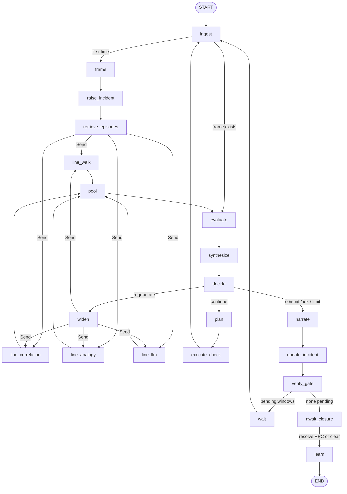

# 05 — LangGraph Implementation and LLM Configuration

The decision procedure (doc 04) is implemented as a LangGraph `StateGraph`, which lives in procedural memory. The graph's state is working memory. Its nodes call the reasoning procedures, and the long-term memories through their `Protocol` interfaces.

The LLM backend is chosen by configuration:

- DeepSeek;
- a local vLLM, Ollama or any other OpenAI-compatible server;
- no LLM at all.

The configuration convention follows `.env.example`.

## 1. State (working memory)

```python
# diag_agent/working_memory/state.py
class DiagnosisState(TypedDict, total=False):
    question: Question                       # anchor, t_question, operator text
    clock: float                             # agent time, s after the onset reference
    incident_no: str                         # uint64 as string, e.g. "1001"
    raw_incident_id: int                     # simulator incidents.id (replay)
    frame: CaseFrame | None
    windows: dict[str, Window]               # prediction id → window and state
    line_results: Annotated[dict[str, LineResult], merge_dict]    # fan-in from Send
    hypotheses: dict[str, Hypothesis]        # H# → mode, location, members, provenance
    ledger: Ledger                           # prior, terms[], log-posteriors, NOTA, entropy history
    tree: Annotated[list[TreeNode], append_nodes]                 # append-only deltas
    plan: Plan | None                        # ranked actions, chosen action, rationale
    budget: Budget                           # checks, effort_h, returns, llm_calls, tokens
    obs_log: Annotated[list[Observation], operator.add]
    pending_check: CheckRequest | None       # set before interrupt() for field checks
    decision: Literal["commit", "continue", "regenerate", "idk", "limit"] | None
    incident: IncidentView                   # ietf-incident view under construction (doc 06)
    pass_no: int                             # return pass 0..3
```

**Reducers.** Two reducers merge concurrent writes:

- `merge_dict` merges the parallel generation lines.
- `append_nodes` appends tree deltas, de-duplicated by node id.

**Ownership.** Every other slot is owned by exactly one node (doc 02 §2). A unit test checks this: it compares each node's returned keys against an ownership map.

## 2. Graph



In outline:

```
START → ingest → frame → raise_incident → retrieve_episodes ⇉ line_* (Send fan-out) → pool
      → evaluate → synthesize → decide
            continue   → plan → execute_check (CHK_WAIT advances the clock; field → interrupt) → ingest
            regenerate → widen ⇉ line_* → pool …
            commit/idk/limit → narrate → update_incident → verify_gate
                                   pending windows → wait → ingest → evaluate … (verify mode)
                                   none pending    → await_closure (interrupt) → learn → END
```

| Node | Procedure (doc 04) | Reads | Writes |
|---|---|---|---|
| `ingest` | Substrate read up to `clock` (allowlisted) | clock | obs_log |
| `frame` | §3 framer, onset, windows | obs_log, semantic memory | frame, tree |
| `raise_incident` | doc 06 §3; incident created when the frame forms | frame | incident, plus a `raised` notification |
| `retrieve_episodes` | §10 retrieval | frame (role form) | line_results["analogy"] input |
| `line_*` | §4, one node per line, run in parallel through `Send` | frame, semantic memory | line_results, tree |
| `line_llm` | §5, a ReAct **subgraph** | frame, KG tools | line_results["llm"], tree (pruned proposals) |
| `pool` | §4.5 | line_results | hypotheses, ledger.prior, tree |
| `evaluate` | §6, propagation and window states | hypotheses, obs_log, clock | windows, tree (`evaluate`, `question`) |
| `synthesize` | §7.1 ledger | windows, checks done | ledger, tree (`synthesis`) |
| `decide` | §7.3 decide, a pure function used as the conditional edge | ledger, windows, budget | decision, tree (`decision`) |
| `plan` | §8.1 advisor and §8.2 orchestrator | ledger, hypotheses, windows | plan, tree (`check` plus forward branches) |
| `execute_check` | §8.3 dispatch. Remote checks run directly. Field checks call `interrupt(pending_check)` in live mode, or ask the `FieldOracle` in replay. | plan | obs_log, clock, budget |
| `wait` | `CHK_WAIT`: advance the clock to the next window closure | windows | clock |
| `widen` | §7.4 return pass | pass_no | pass_no, frame (wider), budget |
| `narrate` | §11 | ledger, tree | incident.description |
| `update_incident` | doc 06 §5 mapper | ledger, hypotheses | incident, plus an `updated` notification |
| `verify_gate` | Pending windows left → `wait` → `ingest`; otherwise → `await_closure` | windows | — |
| `await_closure` | `interrupt()` until the incident is resolved (RPC) or cleared (substrate); replay mode auto-resumes at the recorded clear | — | incident (cleared) |
| `learn` | doc 02 §6.3, the learning writers | everything | episodic memory, semantic memory (incident graph, stats) |

```python
# diag_agent/procedural_memory/decision_procedure/graph.py (sketch)
def build_graph(deps: Deps) -> CompiledStateGraph:
    g = StateGraph(DiagnosisState)
    for name, fn in nodes(deps).items():
        g.add_node(name, fn)
    g.add_node("line_llm", build_proposer_subgraph(deps))
    g.add_edge(START, "ingest")
    g.add_conditional_edges("ingest", after_ingest, ["frame", "evaluate"])
    g.add_edge("frame", "raise_incident")
    g.add_edge("raise_incident", "retrieve_episodes")
    g.add_conditional_edges("retrieve_episodes", fan_out_lines)      # → [Send("line_walk", s), …]
    g.add_conditional_edges("widen", fan_out_lines)
    for line in deps.config.agent.lines:
        g.add_edge(f"line_{line}", "pool")
    g.add_edge("pool", "evaluate")
    g.add_edge("evaluate", "synthesize")
    g.add_edge("synthesize", "decide")
    g.add_conditional_edges("decide", route_decision,
        {"commit": "narrate", "continue": "plan",
         "regenerate": "widen", "idk": "narrate", "limit": "narrate"})
    g.add_edge("plan", "execute_check")
    g.add_edge("execute_check", "ingest")
    g.add_edge("wait", "ingest")
    g.add_edge("narrate", "update_incident")
    g.add_edge("update_incident", "verify_gate")
    g.add_conditional_edges("verify_gate", route_verify, ["wait", "await_closure"])
    g.add_edge("await_closure", "learn")
    g.add_edge("learn", END)
    return g.compile(checkpointer=deps.checkpointer)
```

**Loop guards.**

- **Step limit.** `recursion_limit` is computed from the budget (12 checks × 6 nodes + margin).
- **Post-commit verification.** After a commit, `decide` runs in *verify* mode. In this mode it never routes to `plan`, and it calls `update_incident` only when the leader or NOTA has moved by at least 0.01.

## 3. The LLM proposer subgraph

`line_llm` is a small ReAct agent over the guarded KG tools of doc 04 §5.1:

```
proposer_start → llm_step ─tool_calls→ kg_tools (ToolNode) → llm_step … (≤ 8 tool calls)
                         └─final JSON→ validate_and_resolve → END
```

1. **`llm_step`.** Binds the six tools with `bind_tools`.
2. **`kg_tools`.** A `ToolNode` that wraps `SemanticMemory` plus the scope guard, and appends to `walk_visited`.
3. **Budget exhaustion.** When the budget is used up, the next `llm_step` is called *without* tools and with the instruction "produce the final JSON now".
4. **`validate_and_resolve`.** Runs the six checks of doc 04 §5.3. Its output is a `LineResult` plus `pruned` tree nodes.
5. **Capability fallback.** If the model has no native tool calling (capability `tools: prompted`), the same loop runs with a prompted JSON action format (`{"tool": "...", "args": {...}}`), which is parsed by the same Pydantic models.

## 4. Persistence, time travel and the step-through demo

- **Checkpointer.** `SqliteSaver` (from `langgraph-checkpoint-sqlite`) at `data/diag_agent/checkpoints.sqlite`, with `thread_id = "inc-<incident-no>"`. It records a checkpoint after every node.
- **Step-through.** `diag-agent replay --incident 42 --step` compiles with `interrupt_after=["frame", "pool", "evaluate", "synthesize", "decide", "plan", "execute_check"]`. The CLI prints the state delta and the new tree nodes at each stop, and *Enter* continues. This is how the reasoning steps of doc 07 are demonstrated live.
- **History.** `diag-agent history inc-1001` lists `graph.get_state_history(config)`. `diag-agent tree 1001 --at <checkpoint_id>` renders the tree as it stood at any past step.
- **Field checks in live mode.** The run parks at `interrupt()`. `diag-agent answer inc-1001 --check CHK_OTDR --value '{"break_km": 31.2}'` resumes it with `Command(resume=...)`.

## 5. Streaming

Nodes emit tree deltas and narration through `get_stream_writer()`:

```python
writer({"type": "tree.node", "node": node.model_dump()})
writer({"type": "ledger", "cycle": c, "posterior": post, "nota": nota})
```

Consumers use `graph.stream(..., stream_mode=["updates", "custom"])`:

| Consumer | What it shows |
|---|---|
| CLI | A `rich.Live` tree |
| Incident Server | Server-sent events, as `GET /diag/v1/incidents/{no}/stream` (doc 06 §7) |
| Simulator UI | Can subscribe to the same stream as the CLI and the Incident Server |

## 6. LLM configuration

### 6.1 Roles

The agent uses the LLM in four roles. Each role can use its own profile:

| Role | Used by | Needs | Default |
|---|---|---|---|
| `proposer` | `line_llm` | Tool calling and JSON output; the strongest model available | Profile default, temperature 0.2 |
| `orchestrator` | `plan` (§8.2) | Short JSON choice | Temperature 0 |
| `narrator` | `narrate` | Plain text | Temperature 0.3 |
| `interface` | Operator dialogue (CLI chat, the `description` field) | Plain text | Temperature 0.3 |

### 6.2 `config/diag_agent.yaml`

```yaml
llm:
  profile: ${DIAG_LLM_PROFILE:-env}          # env | deepseek | local_vllm | ollama | none
  roles:
    proposer:     { temperature: 0.2, max_tokens: 2000 }
    orchestrator: { temperature: 0.0, max_tokens: 400 }
    narrator:     { temperature: 0.3, max_tokens: 800 }
    interface:    { temperature: 0.3, max_tokens: 800, profile: null }  # per-role profile override
  profiles:
    env:            # exactly the .env.example convention
      base_url: ${VLLM_API_BASE}
      model:    ${VLLM_MODEL}
      api_key:  ${VLLM_API_KEY}
      structured_output: auto          # auto | json_schema | json_mode | prompted
      tools: auto                      # auto | native | prompted
    deepseek:
      base_url: https://api.deepseek.com/v1
      model: ${DEEPSEEK_MODEL:-deepseek-v4-flash}
      api_key: ${DEEPSEEK_API_KEY:-${VLLM_API_KEY}}
      structured_output: json_mode     # JSON mode + Pydantic validation + one repair retry
      tools: native
      timeout_s: 60
      max_retries: 2
    local_vllm:
      base_url: ${VLLM_API_BASE:-http://192.168.198.141:8000/v1}
      model: ${VLLM_MODEL:-qwen3.5-9B-awq-4bit}
      api_key: ${VLLM_API_KEY:-test123}
      structured_output: json_schema   # vLLM guided decoding
      tools: native                    # requires --enable-auto-tool-choice --tool-call-parser hermes
      extra_body: { chat_template_kwargs: { enable_thinking: false } }   # Qwen3 family
      timeout_s: 120
    ollama:
      base_url: http://localhost:11434/v1
      model: qwen3:8b
      api_key: ollama
      structured_output: json_schema
      tools: prompted
    none: {}                           # LLM roles disabled: proposer line abstains, template narration
  cache:
    enabled: true                      # SQLite response cache keyed by (profile, model, prompt hash)
    path: data/diag_agent/llm_cache.sqlite
    mode: read_write                   # read_write | read_only (CI replay) | off

agent:
  lines: [walk, correlation, analogy, llm]          # "standard"; add set_cover, ppr, shared_risk, monitoring, trend for "full"
  line_weights: { specialised: 0.25 }
  frame: { hold_s: 32, view: raw, scope_hops: 2 }
  ppe_access: on_demand                            # on_demand | streamed
  ledger: { clip_nats: 8, commit_p: 0.80, nota_max: 0.20, residual_nats: 4.5, set_mass: 0.90,
            regenerate_nota: 0.25, stall_bits: 0.10, stall_terms: 3 }
  advisor: { gate_hours: 0.5, gate_p: 0.05, site_hours: 2, interrupt_hours: 1,
             max_checks: 12, max_effort_h: 8, max_returns: 3, forward_depth: 3, forward_min_mass: 0.01 }
  proposer: { max_tool_calls: 8, max_neighbors: 30 }

substrate:
  mode: replay                                     # replay | live
  incidents_db: ${FMA_INCIDENTS_DB:-data/incidents.db}
  yang_dir: ${FMA_YANG_DIR:-data/yang}
  kg_engine_url: http://127.0.0.1:5001             # live: SSE alarm.raise / topology.* / ppe.update
  simulator_url: http://127.0.0.1:5000

memory:
  semantic: { backend: rdflib, path: data/diag_agent/semantic.trig, kb_release: kb-2026.11.0 }
  episodic: { path: data/diag_agent/episodes.sqlite, k: 20 }
  checkpoints: data/diag_agent/checkpoints.sqlite

incident_server:
  host: 127.0.0.1
  port: 8040
  payload_mode: extended                           # strict | extended (doc 06 §5.2)
  auto_diagnose: true                              # self-diagnosis on raise (doc 06 §4)
  resolve_timeout_h: 4                             # doc 06 §6.3
  network_refs: { optical: optical-topo, otn: otn-topo }
  incident_no_start: 1001
  validate: debug                                  # always | debug | sample (doc 06 §9)
```

### 6.3 Precedence and loading

Settings are resolved in this order, highest first:

1. CLI flags, for example `--llm-profile deepseek` or `--no-llm`.
2. Process environment: `DIAG_LLM_PROFILE`, `VLLM_*`, `DEEPSEEK_*`, `FMA_*` and `DIAG__AGENT__LEDGER__COMMIT_P=0.85`, which uses `pydantic-settings` nested keys.
3. `.env` at the repository root, loaded with `python-dotenv`. It does not override variables already set, which matches the note in `.env.example`.
4. `config/diag_agent.yaml`, with `${VAR:-default}` interpolation.

`FMA_NO_LLM=1` is honoured as an alias of `--no-llm`, and forces profile `none`.

**Default profile.** The default profile is **`env`**, so an existing `.env` works unchanged. To switch from DeepSeek to the local vLLM, swap the three `VLLM_*` lines exactly as `.env.example` describes, or set `DIAG_LLM_PROFILE=local_vllm`.

### 6.4 Provider construction

```python
# diag_agent/procedural_memory/llm/providers.py (sketch)
def make_chat(role: str, s: Settings) -> BaseChatModel | None:
    p = s.llm.profile_for(role)               # role override or global profile
    if p.name == "none":
        return None
    return ChatOpenAI(base_url=p.base_url, api_key=p.api_key, model=p.model,
                      temperature=s.llm.roles[role].temperature,
                      max_tokens=s.llm.roles[role].max_tokens,
                      timeout=p.timeout_s, max_retries=p.max_retries,
                      extra_body=p.extra_body or None)
```

**Structured output** (`llm/structured.py`):

| Setting | How it works |
|---|---|
| `json_schema` | `with_structured_output(Model, method="json_schema")`. This is guided decoding on vLLM. |
| `json_mode` | `response_format={"type": "json_object"}` with the schema in the prompt, then Pydantic parsing. On failure, one *repair* call sends the validation error back. On a second failure, the role abstains. |
| `prompted` | Plain completion, with the JSON block extracted, then validated. |
| `auto` | At start-up, a capability probe sends a tiny JSON-schema request and a tool-call request, and the result is cached per (base_url, model). |

**Things to watch per backend:**

- **DeepSeek reasoning models** return `reasoning_content` separately. It is logged but never parsed, and never used as a rationale shown to the operator. Reasoning models may reject `tool_choice` and JSON mode. If so, the probe records `tools: prompted` and `structured_output: prompted`.
- **Local models** (around 9 B, quantised) handle the tool loop less reliably. Their proposals still pass the same validation, and failures simply add mass to the residual, which is the intended degradation. The scenario matrix (doc 07 §9) reports accuracy per profile.

### 6.5 Reproducibility

- **Recorded fields.** Every LLM call records the profile, model, prompt version and hash, and the token counts in `budget` and in the episode.
- **Replay determinism.** CI and replay tests run with `cache.mode: read_only` and a recorded cassette, or with the scripted fake `LLMProvider`, so results are bit-for-bit repeatable.
- **Without an LLM.** `--no-llm` runs the full procedure with the LLM line abstaining. The fibre-cut test still commits in this mode (doc 07 §9).

## 7. Dependencies

These additions go to `requirements.txt` (§5.4 of doc 01). The user's working copy already removes Google ADK, which LangGraph replaces.

```
langgraph>=0.4
langgraph-checkpoint-sqlite>=2.0
langchain-openai>=0.3
langchain-core>=0.3
rdflib>=7.1
pyoxigraph>=0.4          # optional fast store
pydantic-settings>=2.6
pyyaml>=6.0
rich>=13.7
sse-starlette>=2.1       # incident server SSE
yangson>=1.5             # payload validation (doc 06 §9)
import-linter>=2.1       # decoupling contracts (doc 02 §8)
```

## 8. CLI

```
diag-agent kb build                 # load ontology + KB + YANG → data/diag_agent/semantic.trig
diag-agent kb conformance           # doc 03 §8
diag-agent replay --incident 42 [--step] [--llm-profile deepseek|local_vllm|none] [--ppe streamed]
diag-agent live                     # subscribe to kg_engine SSE, diagnose new incidents
diag-agent serve                    # Incident Server API (doc 06) on :8040
diag-agent tree 1001 [--view decision|trace] [--format ascii|mermaid|json] [--at <checkpoint>]
diag-agent history inc-1001
diag-agent answer inc-1001 --check CHK_OTDR --value '{...}'
diag-agent score --dataset data/incidents.db --limit 200     # doc 07 §8
```
