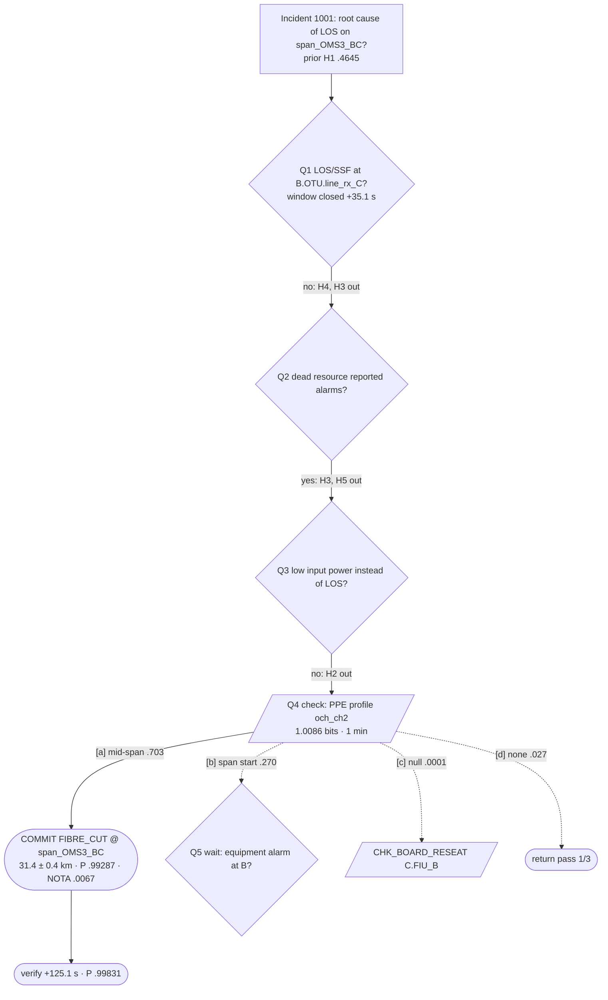

# 07 — Test Case: Diagnosing a Fibre Cut on span_OMS3_BC

This test case shows, end to end and step by step, how `diag_agent` diagnoses a simulator fibre cut. It covers:

- the case frame;
- hypothesis generation, including the KG-walk-guardrailed LLM;
- winnowing;
- the Bayesian ledger;
- check selection;
- the commit;
- how the diagnosis tree grows;
- the `ietf-incident` JSON payloads.

**Why this fault.** `span_OMS3_BC` (B→C) carries two channels, ch2 (A→B→C) and ch4 (D→B→C). The cut also has two look-alike causes that alarms alone cannot separate within the first minute: an amplifier failure at B and an FIU board failure at B. The agent must therefore *ask a question*, the PPE profile, to commit.

**How the numbers were computed.** Every number below comes from the rules of doc 04, using the four-decimal priors shown. Unrounded arithmetic differs only in the fifth decimal.

## 1. What is demonstrated

| Requirement | Where in this test |
|---|---|
| Agent-led KG walk guardrailing the LLM | §4.2, the LLM's tool trace, validation and pruned proposals |
| Winnowing | §4.4, likelihood terms; a prediction stays pending until its observation window closes |
| Analogy with episodic memory | §4.2, the analogy line |
| Bayesian synthesis | §4.4, §4.6, §4.7, the ledger tables |
| Diagnosis tree, displayable | §5, ASCII snapshots per cycle and the final Mermaid tree |
| ietf-incident JSON payloads | §6 and `examples/*.json`, validated with `yangson` |

## 2. Set-up

1. **Prerequisites** (doc 01 §5.4):
   - `data/yang/*.json` must be present.
   - Copy `simulator/kg_lib/alarm_*.json` to `data/`.
   - Run `pip install -r requirements.txt`.
2. **Build semantic memory.** Run `diag-agent kb build`. It loads the ontology, the KB (`kb-2026.11.0`) and the lab-mesh topology into `data/diag_agent/semantic.trig`. Then run `diag-agent kb conformance` (doc 03 §8).
3. **Freeze the incident fixture.**
   - `/api/trigger` seeds its PPE generator from the clock, and the polling delays are random. The demo therefore replays a **frozen** database instead of re-triggering.
   - The fixture was made once with the request below. It was recorded as raw incident **42** and suppressed incident 43, with `created_at` set to `2026-11-02T09:30:00Z`. It is kept as `tests/diag_agent/fixtures/fiber_cut_oms3.db`.

     ```bash
     curl -s -X POST http://127.0.0.1:5000/api/trigger \
          -H 'Content-Type: application/json' \
          -d '{"fault_type": "fiber_cut", "args": ["span_OMS3_BC"]}'
     ```
4. **Episodic memory (warm mode).** The fixture `tests/diag_agent/fixtures/episodes_warm.sqlite` holds 12 closed episodes from earlier replays of other incidents. Among them is a verified (1.0) fibre cut on `span_OMS6_DE`, and none involves OMS3.
5. **Scenario script.** `tests/diag_agent/scenarios/fiber_cut_oms3.yaml`:

   ```yaml
   incident_db: tests/diag_agent/fixtures/fiber_cut_oms3.db
   raw_incident_id: 42
   view: raw
   ppe_access: on_demand
   llm: { profile: deepseek, cache: { mode: read_only, path: tests/diag_agent/cassettes/fiber_cut_oms3.sqlite } }
   episodic: tests/diag_agent/fixtures/episodes_warm.sqlite
   client_script:                      # the OSS side, driven by the replay clock
     - { at: "+40s",       rpc: incident-diagnose,    input: { ticket-no: TT-20261102-0042 } }
     - { at: "09:35:00Z",  rpc: incident-acknowledge, input: { ticket-no: TT-20261102-0042 } }
     - { at: "10:40:00Z",  rpc: incident-resolve,     input: { ticket-no: TT-20261102-0042 } }
   repair: { at: "10:52:10Z", clears: root_symptoms, note: "break found 31.2 km from B, spliced" }
   field_oracle: enabled               # not used in this run (no field check is chosen)
   ```
6. **Run.** Use `diag-agent replay --scenario tests/diag_agent/scenarios/fiber_cut_oms3.yaml --step` for the interactive step-through (doc 05 §4). Without `--step`, it runs to closure and prints the final tree. In another shell, `diag-agent serve` exposes the incident API and the SSE streams.

## 3. What the substrate holds, and what the agent sees

The agent sees an alarm only when its *observed* time (`created_at + t_observed_ms`) is at or before the agent clock. `t_offset_ms`, `fault_type` and `fault_target`, and the PPE emitter rows, are invisible to it (doc 01 §5.3).

| Observed (s after 09:30:00Z) | Row / event id | Alarm or observation | Resource | Container |
|---|---|---|---|---|
| +3.1 | 811 / `alm-42-811` | `OTS_LOS` | C.FIU.line_from_B | span_OMS3_BC |
| +4.4 | 812 / `alm-42-812` | `MUT_LOS` | C.FIU.line_from_B | span_OMS3_BC |
| +7.9 | 813 / `alm-42-813` | `R_LOS` (OCh) | C.OTU.line_rx_B | otu_OMS3_BC |
| +12.5 | PPE row | Detector: `step` on och_ch2, z = 131.4 km, −30 dB, confidence 0.95 | C.OTU (och_ch2 drop) | — |
| +18.6 | 814 / `alm-42-814` | `OTU_SSF` | C.OTU.line_rx_B | otu_OMS3_BC |
| +23.2 | 815 / `alm-42-815` | `ODU_PM_SSF` | C.OTU.client_ch2 | odu_ch2 |
| +26.0 | 816 / `alm-42-816` | `OTU_BDI` | B.OTU.line_tx_C | otu_OMS3_BC |
| +27.3 | PPE row | Detector: `step` on och_ch4, z = 106.4 km, −30 dB | C.OTU (och_ch4 drop) | — |
| +51.7 | 817 / `alm-42-817` | `ODU_PM_SSF` | C.OTU.client_ch4 | odu_ch4 |
| +4 … +70 | 818–851 | 34 L1 suppression-graph and L2 keyword alarms | various at C and B | — |

The PPE rows are reachable only through `CHK_PPE_PROFILE`, because the PPE access mode is `on_demand`.

**Illustrative lengths.** L(OMS2) = 100 km and L(OMS5) = 75 km are the YANG lengths assumed for this fixture, and L(OMS3) = 75 km. The PPE path coordinate on ch2 is therefore z = 100 + 31.4 = 131.4 km.

## 4. The reasoning, step by step

### 4.1 Cycle 0: framing (agent clock +35.6 s)

The first alarm is ingested at +3.6 s. Framing waits for the hold (32 s) and runs at +35.6 s.

**Onset interval.** OTS_LOS (+3.1 s, cadence 5 s) gives [−1.9, 3.1], and MUT_LOS (+4.4 s, 5 s) gives [−0.6, 4.4]. The intersection is **[−0.6 s, +3.1 s]**, i.e. 09:29:59.4Z to 09:30:03.1Z.

**Case frame (instance form):**

| Ref | Item | Layer | Evidence | t (s) |
|---|---|---|---|---|
| S1 | LossOfSignal @ C.FIU.line_from_B | OTS | 811, plus 812 folded in (suppression child) | 3.1 |
| S2 | LossOfSignal @ C.OTU.line_rx_B | OCh | 813 | 7.9 |
| S3 | ServerSignalFail @ C.OTU.line_rx_B | OTU | 814 | 18.6 |
| S4 | ServerSignalFail @ C.OTU.client_ch2 | ODU | 815 | 23.2 |
| S5 | BackwardDefect @ B.OTU.line_tx_C | OTU | 816 | 26.0 |
| S6 | Keyword-correlated alarm group with no documented condition at its location | — | L2 rows | — |
| V1 | ch2: down | service | via S4 | — |
| V2 | ch4: at risk (its path includes E1, which carries a hard symptom) | service | scope closure | — |
| E1 | span_OMS3_BC: shared by V1 and V2 | — | — | — |
| E2 | OMS3 (section) | — | — | — |
| E3 | C.OTU (drop board of V1 and V2) | — | — | — |

**Quiet instruments:**

| Instrument | Layer | Window closes (s) |
|---|---|---|
| B.FIU.line_from_C | OTS | 10.1 |
| B.OTU.line_rx_C | OCh / OTU | 15.1 / 35.1 |
| A rx of span_OMS2_BA; D rx of span_OMS5_BD | OTS | 10.1 |
| C drops of ch1 and ch3 | ODU | 65.1 (open) |
| Equipment at B and C | Equipment | 125.1 (open) |

**Role form**, used for analogy: `{LOS[OTS]@rx_of_span(E1), LOS[OCh]@rx_of_otu_over(E1), SSF[OTU]@…, SSF[ODU]@client_of(V1), BDI[OTU]@tx_of_otu_over(E1); services: 2 sharing 1 span; quiet: reverse_span rx, far-end OTU rx}`.

**Incident raised.** `incident-no` 1001 is assigned, with name "Loss of signal on span_OMS3_BC". The `raised` notification is sent (`examples/01-notification-raised.json`) and task `dx-1001-1` is created.

### 4.2 Cycle 1, propose: four generation lines

**Abduction walk.** From S1, the inverse of `SPAN_RX_PORT` gives `span_OMS3_BC`. Further roles reach `B.OA_C` (`RX_OF_SPAN_LAUNCHED_BY_AMP`⁻¹), `B.FIU_C` and `C.FIU_B` (`PEER_RX_OF_LINKS_FROM_BOARD`⁻¹ and `SELF`), and NE B.

The documented modes at those grains are scored. S6 is unexplained by every candidate, so the unexplained share is 1/8 and the residual is 0.05 + 0.4 × 0.125 = **0.10**.

| Candidate | Score | Walk p |
|---|---|---|
| H1 FIBRE_CUT@span_OMS3_BC | 7 explained | .40 |
| H9 AMP_FAIL@B.OA_C | 7 explained, equipment pending | .20 |
| H4 BOARD_POWER_LOSS@B.FIU_C | 7 − 2 missing | .12 |
| H3 BOARD_POWER_LOSS@C.FIU_B | — | .10 |
| H2 SPAN_LOSS_INCREASE@span_OMS3_BC | — | .05 |
| H5 NE_POWER_LOSS@B | — | .03 |
| *pruned* H6 SECTION_CUT@OMS3 | ≤ 0: reverse-fibre rx quiet | — |
| *pruned* H7 NE_POWER_LOSS@C | ≤ 0: C reported alarms | — |
| *pruned* H8 CONNECTOR_DIRTY@span_OMS3_BC | ≤ 0: explains no LOS | — |

**Alarm correlation.** The possible causes of `OTS_LOS` are FIBRE_CUT, SECTION_CUT, AMP_FAIL, BOARD_POWER_LOSS and NE_POWER_LOSS. After the quiet-instrument filter, H1, H9 and H4 remain at 0.3 each, with residual 0.10.

**Analogy.** Twenty episodes are retrieved. The best is a verified fibre cut on span_OMS6_DE with similarity 0.80, so the residual is 0.05 + 0.5 × 0.2 = 0.15. Each conclusion relation is resolved onto this incident; for example, "FIBRE_CUT at `upstream_span(S1)`" maps to `span_OMS3_BC`. The line gives H1 .62, H4 .18 and H3 .05. AMP_FAIL has never occurred in episodic memory, so the analogy line gives it nothing; the walk and the LLM bring it in.

**LLM proposer (DeepSeek, cassette).** The tool trace was:

```
1 frame_get()
2 kg_term("upstream_span", "S1")             → [span_OMS3_BC]
3 kg_modes("span_OMS3_BC")                    → [FIBRE_CUT, SPAN_LOSS_INCREASE, CONNECTOR_DIRTY]
4 kg_term("upstream_amplifier", "S1")        → [B.OA_C]
5 kg_modes("B.OA_C")                          → [AMP_FAIL, BOARD_POWER_LOSS]
6 kg_preview("FIBRE_CUT", "upstream_span", "S1")   → explained 7, missing 0, pending 2
7 kg_term("upstream_tx_unit", "S1")          → [B.FIU_C]
8 kg_preview("BOARD_POWER_LOSS", "upstream_tx_unit", "S1") → explained 6, missing 2, pending 1
```

Its output was H1 .55, AMP_FAIL@`upstream_amplifier(S1)` .20, BOARD_POWER_LOSS@`upstream_tx_unit(S1)` .10, BOARD_POWER_LOSS@`this_unit(S1)` .05, `WSS_PORT_FAIL`@`this_port(S1)` .04, and NOTA .06.

Validation (doc 04 §5.3):

- The first four proposals resolve to H1, H9, H4 and H3, and each resolved resource is in `walk_visited`.
- `WSS_PORT_FAIL` is **not a documented mode**, so its .04 goes to the residual and a `pruned` node records it.
- The line residual is .06 + .04 = .10.

### 4.3 Pooling (four lines, weight 1 each, 1% floor)

| | H1 | H9 | H4 | H3 | H2 | H5 | NOTA |
|---|---|---|---|---|---|---|---|
| Walk | .40 | .20 | .12 | .10 | .05 | .03 | .10 |
| Correlation | .30 | .30 | .30 | | | | .10 |
| Analogy | .62 | | .18 | .05 | | | .15 |
| LLM | .55 | .20 | .10 | .05 | | | .10 |
| **Prior** | **.4645** | **.1749** | **.1749** | **.0512** | **.0140** | **.0091** | **.1114** |

### 4.4 Cycle 1, winnowing at +35.6 s

The observation-window states that feed the winnowing terms:

| Hypothesis | Matched | Missing (window closed, instrument alive) | Pending / unobservable |
|---|---|---|---|
| H1 FIBRE_CUT@span_OMS3_BC | S1–S5, V1 | — | ODU SSF ch4 (until 65.1); PPE (not consulted) |
| H9 AMP_FAIL@B.OA_C | S1–S5, V1 | — | EquipmentDown@B.OA_C (until 125.1); PPE |
| H4 BOARD_POWER_LOSS@B.FIU_C | S1–S5, V1 | OCh LOS and OTU SSF at B.OTU.line_rx_C: **−4** | EquipmentDown (until 125.1) |
| H3 BOARD_POWER_LOSS@C.FIU_B | — | OTS LOS at B.FIU.line_from_C, plus OCh LOS and OTU SSF at B.OTU.line_rx_C: **−6** | — |
| H2 SPAN_LOSS_INCREASE | — | LowInputPower at S1 (contradicted by LOS), plus 5 unexplained LOS-family items: **−8** (cap) | — |
| H5 NE_POWER_LOSS@B | — | OTS LOS at A and D receivers, plus their OCh LOS: **−8** (cap) | — |

Under H3, the dead board `C.FIU_B` reported S1 itself; under H5, the dead NE B reported S5. Both therefore trigger R6.

| | H1 | H9 | H4 | H3 | H2 | H5 | NOTA |
|---|---|---|---|---|---|---|---|
| `T_doc` (tau 0.7) | 0 | 0 | −4 | −6 | −8 | −8 | −2 (charged) |
| `T_gc` (tau 0.3) | 0 | 0 | −4 (R1) | −8 (R1, R6) | −8 (R1, R3) | −8 (R1, R6) | −1.4562 (neutral) → −0.4369 tempered |
| **Posterior** | **.70333** | **.26483** | .00485 | .000105 | .0000071 | .0000046 | **.02687** |

### 4.5 Cycle 1, decide and plan

**Commit test.**

| Condition | Result |
|---|---|
| P(H1) ≥ 0.80 | ✗ (.70333) |
| NOTA < 0.20 | ✓ |
| Terms evaluated or declined | ✓ |
| Residual test | ✓ |

The decision is **CONTINUE**. There is no regeneration: NOTA is .027, well below .25, and the entropy fell from 2.11 to 1.04 bits.

**Advisor.**

| Check | Answer classes | Bits | Effort | Bits/h |
|---|---|---|---|---|
| **CHK_PPE_PROFILE(och_ch2)** | mid-span step: H1 (.70333)<br>span-start step: H9, H4, H5 (.26968)<br>null: H3 (.0001055)<br>none: NOTA, H2 (.02688) | 1.0086 | 1 min | **60.5** |
| CHK_WAIT (equipment window) | equipment-down (.26979)<br>none (.73021) | 0.841 | 89.5 s | 33.8 |
| CHK_ALARM_AUDIT(B) | Same partition | 0.841 | 2 min | 25.2 |
| CHK_OTDR(span_OMS3_BC) | break (.70333)<br>no break | 0.877 | 2.75 h | 0.32 |
| CHK_REVERSE_FIBRE, CHK_SERVICE_STATE | All hypotheses predict the same answer | ≈ 0 | — | excluded |

**Orchestrator.** It chose CHK_PPE_PROFILE, with the rationale: "one-minute remote read; separates a mid-span break from failures at the span start at B". The tree gains the check node and four answer branches, three of them forward-planned (§5).

### 4.6 Cycle 2: the check answer and its evaluation (+95.6 s)

The answer arrives at +95.6 s, after the check's one minute:

```
och_ch2: step, z = 131.4 km → span_OMS3_BC, offset 31.4 km (of 75), −30 dB, confidence 0.95
```

This is answer class [a]. Meanwhile, alarm 817 (`ODU_PM_SSF` on ch4, +51.7 s) has arrived. It matches H1's pending prediction and becomes frame item S7, and V2 changes to *down*.

| | H1 | H9 | H4 | H3 | H2 | H5 | NOTA |
|---|---|---|---|---|---|---|---|
| `T_ppe` (tau 0.7) | 0 | −8 | −8 | −8 | −8 | −8 | −2 |
| `T_gc` R7 (tau 0.3) | 0 | −4 | −4 | −4 | −4 | −4 | −1.109 (neutral) → −0.3327 |
| **Posterior** | **.99287** | .00042 | .0000076 | — | — | — | **.0067** |

**Commit test.**

| Condition | Result |
|---|---|
| P ≥ .80 | ✓ (.99287) |
| NOTA < .20 | ✓ (.0067) |
| Leader and runner-up fully evaluated or declined | ✓ (H9's equipment window is still pending, which counts as declined) |
| Residual test: largest single-item debit against H1 | ✓ (0 nats, ≤ 4.5) |

The decision is **COMMIT FIBRE_CUT@span_OMS3_BC**, with the fitted position 31.4 ± 0.4 km from B.

The `updated` notification is sent at 09:31:35.6Z (`03-notification-updated-diagnosed.json`), and the task becomes `diagnosed`.

### 4.7 Verification (+125.1 s)

`verify_gate` waits for the equipment window. It closes at +125.1 s with no `BD_OFFLINE`, `HARD_BAD` or `POWER_ABNORMAL` at B or C.

| Hypothesis | Term |
|---|---|
| H9, H4, H3, H5 | `T_doc` −2 and R1 −4 |
| NOTA | Charged −2 |

The posterior becomes **H1 .99831**, NOTA .0016622, H9 .0000311. The leader moved by .0054 and NOTA by .0050, both below 0.01, so no notification is sent; this is the coalescing policy (doc 06 §4). The task becomes `finished` (`09-diagnosis-task-notification.json`).

### 4.8 Closure

| Time | Event | Example |
|---|---|---|
| 09:30:40Z | The OSS's `incident-diagnose` with a ticket **joins** task `dx-1001-1` | `02-*` |
| 09:35:00Z | `incident-acknowledge` → `updated` notification | `04-*` |
| 10:40:00Z | `incident-resolve` is accepted, because a cause is committed | `05-*` |
| 10:52:10Z | The scripted repair clears the root symptoms; `CHK_SERVICE_STATE` shows ch2 and ch4 up → `cleared` | `06-*` |

**Learning.** The episode is written with verification `repair_confirmed` (1.0). The repair note puts the break at 31.2 km, within the 0.4 km fit plus the OTDR tolerance. The RFC 9940 incident graph `g:incident-1001` is published (`ontology/example-lab-mesh.trig`). Base rates are updated, since the verification is at least 0.7. Because no `dx:Procedure` matched, the tree path is queued as a procedure candidate.

## 5. How the diagnosis tree grows (decision view)

**After cycle 1** (+35.6 s):

```
Incident 1001 — what is the root cause of LOS on span_OMS3_BC?        [prior H1 .4645 → .70333]
├── Q1 LOS/SSF at B.OTU.line_rx_C (window closed +35.1 s)?  ─ no ─▶ H4, H3 ≈ eliminated  (IG .77 bit)
├── Q2 Did a resource predicted dead report alarms?  ─ yes (C.FIU, B.OTU) ─▶ H3, H5 eliminated
├── Q3 Low input power instead of LOS at S1?  ─ no ─▶ H2 eliminated
└── Q4 [check] PPE profile of och_ch2: where is the step?   1.0086 bits, 1 min, 60.5 bits/h   ⧗ running
    ├┄ [a] mid-span            (.703) ┄▶ expect COMMIT FIBRE_CUT
    ├┄ [b] at span start       (.270) ┄▶ Q5 [wait ≤ +125.1 s] equipment alarm at B.OA_C or B.FIU_C?
    ├┄ [c] null                (.0001)┄▶ CHK_BOARD_RESEAT(C.FIU_B)
    └┄ [d] no anomaly          (.027) ┄▶ return pass 1/3
```

**After cycle 2** (+95.6 s): branch [a] is taken and the others stay dashed.

```
└── Q4 [check] PPE profile of och_ch2 …
    ├── [a] mid-span: −30 dB @ 31.4 km in span_OMS3_BC (.703)  ✔
    │   └── ◆ COMMIT FIBRE_CUT @ span_OMS3_BC, 31.4 ± 0.4 km   P = .99287  NOTA = .0067
    ├┄ [b] …   ├┄ [c] …   └┄ [d] …
```

**After verification** (+125.1 s):

```
    │   └── ◆ COMMIT …  P = .99287
    │       └── ✓ verify +125.1 s: no equipment alarm at B or C   P = .99831  NOTA = .0017
```

The **trace view** (`diag-agent tree 1001 --view trace`) shows, in order:

- the frame;
- the four `generate` nodes with their distributions;
- the `pruned` nodes: H6, H7, H8 and `WSS_PORT_FAIL`;
- the `analogy` node, showing the top episode (span_OMS6_DE, similarity 0.80, weight 1.0);
- the pooled `hypothesis` nodes;
- three `evaluate` and `synthesis` pairs (cycle 1, cycle 2, verification);
- the `check` and `answer` nodes;
- the `decision` and `verify` nodes.

**Final tree in Mermaid** (`diag-agent tree 1001 --format mermaid`):



## 6. The ietf-incident payload sequence

| # | Time | Payload | File |
|---|---|---|---|
| 1 | 09:30:35.6Z | Notification `raised`: key, ch2 and ch4, critical, network, 6 events, `decision: in-progress` | `examples/01-notification-raised.json` |
| 2 | 09:30:40Z | RPC `incident-diagnose` (ticket) → output `task-id dx-1001-1` | `02-rpc-diagnose-request.json`, `02-rpc-diagnose-response.json` |
| 3 | 09:31:35.6Z | Notification `updated`: probable cause `fibre-cut` at B / span_OMS3_BC, 8 events including the PPE metric event, P .99287 | `03-notification-updated-diagnosed.json` |
| 4 | 09:31:35.6Z | `diagnosis-task-notification`: finished, succeeded | `09-diagnosis-task-notification.json` |
| 5 | 09:35:00Z | RPC `incident-acknowledge` → notification `updated`, acknowledged, P .99831 | `04-rpc-acknowledge-request.json`, `04-notification-updated-acknowledged.json` |
| 6 | 10:40:00Z | RPC `incident-resolve` (204) | `05-rpc-resolve-request.json` |
| 7 | 10:52:10Z | Notification `cleared` | `06-notification-cleared.json` |
| — | After closure | `GET /restconf/data/ietf-incident:incidents` in strict and extended modes | `07-incidents-strict.json`, `08-incidents-extended.json` |
| — | Error paths | Diagnosing an unknown incident; resolving an uncommitted incident | `10-*.json`, `11-*.json` |

The probable cause, as carried in notification 3 (extended mode):

```json
"probable-causes": {
  "probable-cause": [{
    "node-ref": "B", "network-ref": "optical-topo",
    "cause-name": "diag-agent-incident-ext:fibre-cut",
    "detail": "FIBRE_CUT at span_OMS3_BC; P = 0.99287; runner-up AMP_FAIL at B.OA_C, P = 0.00042.",
    "resource": [{ "name": "span_OMS3_BC",
                   "cause-name": "diag-agent-incident-ext:fibre-cut",
                   "detail": "Break 31.4 +/- 0.4 km from B on a 75 km span; PPE step -30 dB on och_ch2 at z = 131.4 km." }]
  }]
}
```

In strict mode, the same entry carries `"cause-name": "ietf-incident:loss-of-signal"`, and the PPE event has type `ietf-incident:metric`. All example files pass `python docs/design/examples/validate.py`.

## 7. Step-through transcript (abridged)

```
$ diag-agent replay --scenario tests/diag_agent/scenarios/fiber_cut_oms3.yaml --step
[+35.6s] frame        onset [-0.6, +3.1] s · 6 symptoms · 2 services · 3 shared · 8 quiet instruments
[+35.6s] raise        incident-no 1001 "Loss of signal on span_OMS3_BC" → notification raised
[+35.6s] pool         H1 .4645 · H9 .1749 · H4 .1749 · H3 .0512 · H2 .0140 · H5 .0091 · NOTA .1114
                      pruned: H6 SECTION_CUT (reverse rx quiet) · H7 NE_POWER_LOSS@C · H8 CONNECTOR_DIRTY
                      llm: WSS_PORT_FAIL ungrounded (undocumented mode) → +.04 residual
[+35.6s] evaluate     H4 −4 (B.OTU.line_rx_C quiet) · H3 −6 · H2 −8 · H5 −8 · H9 0 (equipment pending to +125.1)
[+35.6s] synthesize   H1 .70333 · H9 .26483 · NOTA .02687              entropy 2.11 → 1.04 bits
[+35.6s] decide       CONTINUE (P .703 < .80)
[+35.6s] plan         CHK_PPE_PROFILE(och_ch2) 60.5 bits/h  >  WAIT 33.8  >  ALARM_AUDIT(B) 25.2  >  OTDR 0.32
[+95.6s] check        och_ch2 step @ z 131.4 km → span_OMS3_BC +31.4 km, −30 dB
[+95.6s] synthesize   H1 .99287 · NOTA .0067 · H9 .00042
[+95.6s] decide       COMMIT FIBRE_CUT@span_OMS3_BC (31.4 ± 0.4 km) → notification updated
[+125.1s] verify      equipment window closed, none seen → H1 .99831 (Δ < .01, no notification)
```

## 8. Acceptance criteria and scoring harness

`tests/diag_agent/test_fiber_cut.py` asserts the following against the replay. The scorer, alone, reads the fixture's labels.

| # | Assertion |
|---|---|
| A1 | The decision is COMMIT on `FIBRE_CUT` at `span_OMS3_BC`. The fitted position is within 2 km of the emitter's planted position (scorer-only `ppe_anomalies` row with `is_root = 1`). |
| A2 | At commit, P ≥ 0.80 and NOTA < 0.20. The agent commits in ≤ 2 decision cycles, using 1 remote check and no field check. |
| A3 | No hypothesis is penalised for an effect whose window was still open. The ODU SSF on ch4 is pending in cycle 1 and matched in cycle 2, and H9's equipment effect is declined until +125.1 s. |
| A4 | Every `hypothesis` node from the LLM line has walk provenance, and `WSS_PORT_FAIL` appears only as a `pruned` node. |
| A5 | The tree contains node kinds `frame`, `generate` (×4), `analogy`, `hypothesis` (×6), `pruned` (≥ 4), `evaluate` (×3), `question` (≥ 3), `check`, `answer` (×4, of which 3 have `taken = false`), `synthesis` (×3), `decision` and `verify`. |
| A6 | All eleven payloads validate (`validate.py`). `probable-events` ⊆ `events`; `incident-no` is constant; and the key `[name type incident-qualifier]` is unchanged across all notifications. |
| A7 | **Leakage.** The substrate access log shows no read of `fault_type`, `fault_target`, `t_offset_ms`, `group_id` or `is_root = 1` rows by any component except the scorer. |
| A8 | **Determinism.** Two runs with the cassette produce byte-identical tree JSON and ledger history. |
| A9 | `--no-llm` also commits to the same cause (§9). |

**As implemented (2026-11).** A1–A9 pass in `tests/diag_agent/test_fiber_cut.py` (no-LLM and cassette). Measured fibre-cut result with warm episodic memory and `--no-llm`: COMMIT `FIBRE_CUT@span_OMS3_BC` at +92.4 s after one `CHK_PPE_PROFILE(och_ch2)`, P ≈ 0.997, position error ≈ 0.002 km, then cleared at the scripted repair (+4930 s). Deviations from the numbers sketched above: the confirm rule groups Required PPE predictions by effect rule (one OCh is enough); R6 is port-level only; the LLM proposer is a ReAct loop in-process (not a LangGraph subgraph); AMP_FAIL is documented only for the single board `B.OA` of this test bed. Scoring: `python -m diag_agent score [--no-llm] [--json FILE]` over `tests/diag_agent/fixtures/variants.db` reports correct commits / wrong commits / truth in the 90% set (currently 9/12, 0/12, 12/12 with or without the LLM).

## 9. Variants

| Variant | Change | Expected result |
|---|---|---|
| Streamed PPE | `ppe_access: streamed` | The PPE terms enter in cycle 1, giving **COMMIT at cycle 1**, P(H1) = .99429. There is no check node. |
| Cold episodic | No episodes, so the analogy line abstains | Prior H1 .4142. Cycle 1: H1 .62214, H9 .34950. Cycle 2 after the same check: **.99339** |
| No LLM | `--no-llm` / `FMA_NO_LLM=1` | Prior H1 .4373. Cycle 1: .69950. Cycle 2: **.99260** |
| Cold and no LLM | Walk and correlation only | Cycle 1: H1 .56555, H9 .40474. Cycle 2: **.99310** |
| Suppressed view | `view: suppressed` (incident 43) | Fewer frame items, since the L1 children are removed. Same leader and same check. |
| `fiber_attenuation_high span_OMS3_BC` | Different fault | `IN_PWR_LOW` and a PPE slope. The leader is SPAN_LOSS_INCREASE, and the check distinguishes slope from step. |
| `board_power_off B.FIU_C` | Look-alike | **Known conformance issue** (doc 03 §8): the simulator emits no downstream OTU cascade, but the KB requires one. Marked `xfail` until the KB or the simulator is reconciled. |
| `trigger_multi`: `fiber_cut span_OMS3_BC` + `fan_failure E` | Compound with disjoint scopes | Two incidents. The fan incident commits on FAN_FAILURE after the environment window (300 s cadence). |
| `connector_dirty span_OMS3_BC` | PPE-only fault | No alarms, so in `on_demand` mode **no incident is raised**. In `streamed` mode the PPE step (−0.5 to −3 dB) raises an incident, and the leader is CONNECTOR_DIRTY. |
